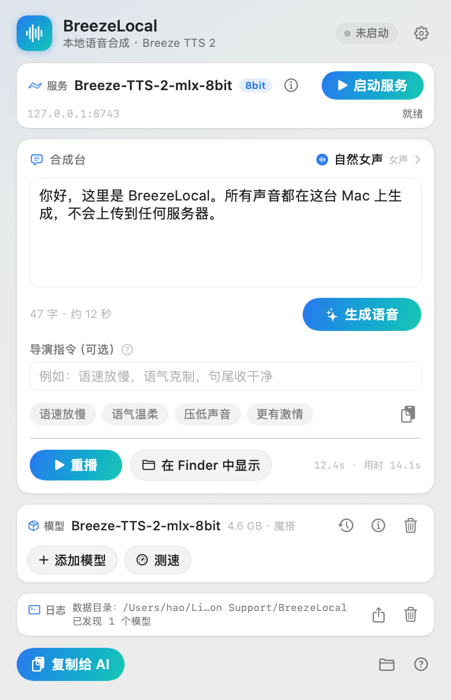
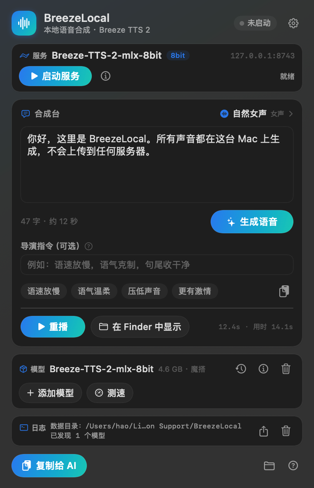
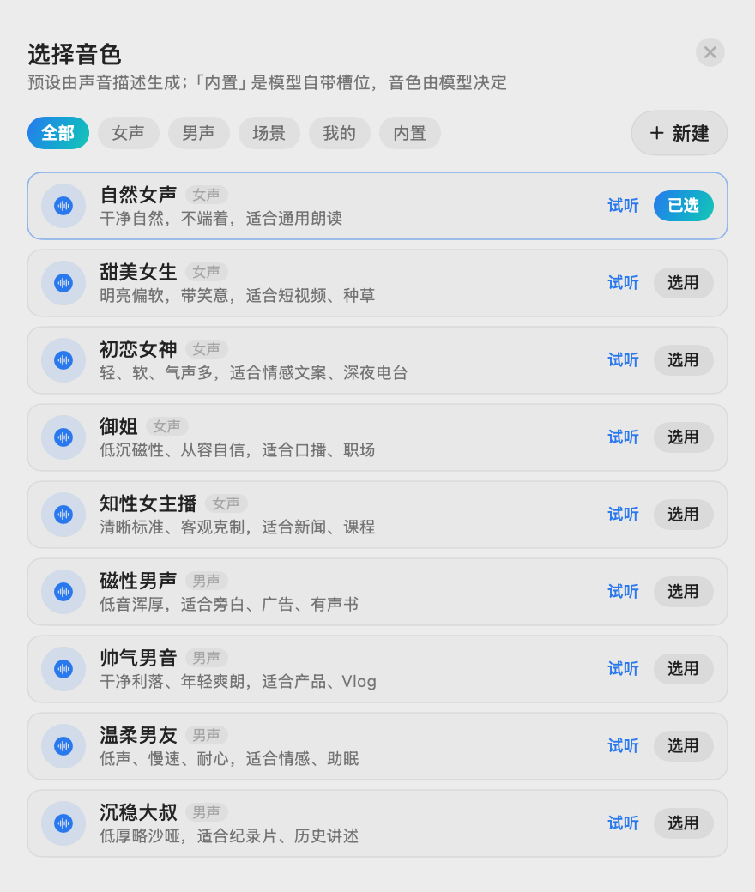

# BreezeLocal

在 Apple Silicon Mac 上本地跑 **Breeze TTS 2** 的原生 macOS App：模型下载与管理、文字转语音、声音设计、声音克隆、本地 MCP 服务，全部在这台机器上完成。

界面与工程结构参照 `Laya Local`（SwiftUI 外壳 + PyInstaller 打包的 Python sidecar），区别是推理层换成 `mlx-audio` + Breeze TTS 2 的 MLX 权重。

> ⚠️ **许可**：Breeze TTS 2 权重受 *BreezeBlue Research and Non-Commercial License* 约束，**仅限研究与非商用**。App 不内置权重，由用户自行下载；商用需向 RESONA / BreezeBlue 取得书面授权。

## 目录

```
BreezeLocal/
├── Sources/BreezeLocal/      SwiftUI 外壳（macOS 14+，arm64）
├── sidecar/                  Python sidecar：模型管理 + TTS + MCP
│   ├── breeze_sidecar.py
│   └── requirements.txt
├── Resources/                Info.plist / AppIcon.icns
├── scripts/                  构建、打包 DMG、校验、清理
├── models/                   开发期模型（已 gitignore）
├── .venv/                    项目内隔离的 Python 环境（已 gitignore）
├── .cache/                   项目内隔离的 pip / HF 缓存（已 gitignore）
└── data/                     开发期数据目录（已 gitignore）
```

## 环境隔离约定

本项目的所有开发依赖都落在项目目录内，**不写系统目录、不动 `~/.cache`、不装全局包**：

| 内容 | 位置 |
|---|---|
| Python 解释器与包 | `BreezeLocal/.venv` |
| pip / uv 缓存 | `BreezeLocal/.cache/uv` |
| HuggingFace 缓存 | `BreezeLocal/.cache/huggingface`（运行时另指 `data/cache`） |
| 模型权重 | `~/Library/Application Support/BreezeLocal/models`（已放好 8bit 模型，约 4.3GB，不用重复下载） |
| 输出音频 | `BreezeLocal/data/outputs/`（开发期）/ App 数据目录（正式运行） |

Python 3.12 使用 uv 已有的解释器（`~/.local/share/uv/python`），不额外下载。
唯一的系统级依赖是 Swift 工具链（`/Library/Developer/CommandLineTools`，本机已有）。

## 实测数据（MacBook Air M4 / 16GB / macOS 15.7，8bit 模型）

| 项目 | 数值 |
|---|---|
| 模型 | `mlx-community/Breeze-TTS-2-mlx-8bit`（4.60 GB，魔搭下载 4 分 49 秒） |
| 冷启动加载 | 21.8 s；同机二次加载 11.1 s |
| 首字延迟 TTFA | 1.2–4.0 s（短句更快） |
| 生成速度 | RTF 1.2–2.1，即 **比实时慢 1.2–2 倍**：10 秒音频约需 12–20 秒 |
| 峰值内存 | Metal 5.6 GB，进程 footprint 约 6.2 GB（16GB 机器安全） |
| 输出 | 24 kHz / 单声道 / 16-bit WAV |
| HTTP 接口 | 200 OK，`X-Audio-Duration` / `X-Audio-RTF` / `X-Audio-TTFA` 回传 |
| MCP | `initialize` / `tools/list` / `tools/call` 全部验证通过 |

参考：官方口径 45 字符/秒是在 H100 上；M4 上实测约 3–5 字符/秒。

## 界面（0.7.0）

- 快捷键改为**可录制**：点按钮直接按下组合（需带 ⌘⌥⌃⇧ 之一），默认 ⌥⌘R，可恢复默认/关闭
- 未生成结果时补一行占位提示，窗口 600 高度下不再出现底部大片空白

## 界面（0.7.0）

- 快捷键改为**可录制**：点按钮直接按下组合（需带 ⌘⌥⌃⇧ 之一），默认 ⌥⌘R，可恢复默认/关闭
- 未生成结果时补一行占位提示，窗口 600 高度下不再出现底部大片空白

## 界面（0.6.0）

- 窗口高度定为 380×600（内容 572），内容区恢复原尺寸（输入框 92pt、卡片间距 8）
- 设置新增「快捷键」：⌥⌘R / ⌥⌘T / ⌃⌥R / ⇧⌘R / 关闭 五档，即时生效并记住选择
- 划词朗读补了全局快捷键，不依赖辅助功能权限；右键服务菜单仍需 App 在「应用程序」中
- MCP 输出（mcp-/design-/clone- 前缀）只保留最近 5 条，`BREEZE_MCP_KEEP` 可调

## 界面（0.7.0）

- 快捷键改为**可录制**：点按钮直接按下组合（需带 ⌘⌥⌃⇧ 之一），默认 ⌥⌘R，可恢复默认/关闭
- 未生成结果时补一行占位提示，窗口 600 高度下不再出现底部大片空白

## 界面（0.7.0）

- 快捷键改为**可录制**：点按钮直接按下组合（需带 ⌘⌥⌃⇧ 之一），默认 ⌥⌘R，可恢复默认/关闭
- 未生成结果时补一行占位提示，窗口 600 高度下不再出现底部大片空白

## 界面（0.6.0）

- 窗口高度定为 380×600（内容 572），内容区恢复原尺寸（输入框 92pt、卡片间距 8）
- 设置新增「快捷键」：⌥⌘R / ⌥⌘T / ⌃⌥R / ⇧⌘R / 关闭 五档，即时生效并记住选择
- 划词朗读补了全局快捷键，不依赖辅助功能权限；右键服务菜单仍需 App 在「应用程序」中
- MCP 输出（mcp-/design-/clone- 前缀）只保留最近 5 条，`BREEZE_MCP_KEEP` 可调

## 界面（0.5.0）

- 「在 Finder 中显示」统一改为「在文件夹中显示」
- 「朗读剪贴板」从图标改成带文字的按钮，放在字数行（生成按钮左侧）；帮助里补了划词朗读两种用法
- 设置面板重排：外观 / 服务 / 维护 / AI 客户端 / 关于，修掉重复的版本行
- 添加模型新增「其他平台（Windows / Linux）」只读清单：官方 PyTorch、GGUF（llama.cpp）、ComfyUI 权重包、INT8，按程序给推荐，可复制命令或打开 HF 页面（不会下载到本机）

## 界面（0.7.0）

- 快捷键改为**可录制**：点按钮直接按下组合（需带 ⌘⌥⌃⇧ 之一），默认 ⌥⌘R，可恢复默认/关闭
- 未生成结果时补一行占位提示，窗口 600 高度下不再出现底部大片空白

## 界面（0.7.0）

- 快捷键改为**可录制**：点按钮直接按下组合（需带 ⌘⌥⌃⇧ 之一），默认 ⌥⌘R，可恢复默认/关闭
- 未生成结果时补一行占位提示，窗口 600 高度下不再出现底部大片空白

## 界面（0.6.0）

- 窗口高度定为 380×600（内容 572），内容区恢复原尺寸（输入框 92pt、卡片间距 8）
- 设置新增「快捷键」：⌥⌘R / ⌥⌘T / ⌃⌥R / ⇧⌘R / 关闭 五档，即时生效并记住选择
- 划词朗读补了全局快捷键，不依赖辅助功能权限；右键服务菜单仍需 App 在「应用程序」中
- MCP 输出（mcp-/design-/clone- 前缀）只保留最近 5 条，`BREEZE_MCP_KEEP` 可调

## 界面（0.7.0）

- 快捷键改为**可录制**：点按钮直接按下组合（需带 ⌘⌥⌃⇧ 之一），默认 ⌥⌘R，可恢复默认/关闭
- 未生成结果时补一行占位提示，窗口 600 高度下不再出现底部大片空白

## 界面（0.7.0）

- 快捷键改为**可录制**：点按钮直接按下组合（需带 ⌘⌥⌃⇧ 之一），默认 ⌥⌘R，可恢复默认/关闭
- 未生成结果时补一行占位提示，窗口 600 高度下不再出现底部大片空白

## 界面（0.6.0）

- 窗口高度定为 380×600（内容 572），内容区恢复原尺寸（输入框 92pt、卡片间距 8）
- 设置新增「快捷键」：⌥⌘R / ⌥⌘T / ⌃⌥R / ⇧⌘R / 关闭 五档，即时生效并记住选择
- 划词朗读补了全局快捷键，不依赖辅助功能权限；右键服务菜单仍需 App 在「应用程序」中
- MCP 输出（mcp-/design-/clone- 前缀）只保留最近 5 条，`BREEZE_MCP_KEEP` 可调

## 界面（0.5.0）

- 「在 Finder 中显示」统一改为「在文件夹中显示」
- 「朗读剪贴板」从图标改成带文字的按钮，放在字数行（生成按钮左侧）；帮助里补了划词朗读两种用法
- 设置面板重排：外观 / 服务 / 维护 / AI 客户端 / 关于，修掉重复的版本行
- 添加模型新增「其他平台（Windows / Linux）」只读清单：官方 PyTorch、GGUF（llama.cpp）、ComfyUI 权重包、INT8，按程序给推荐，可复制命令或打开 HF 页面（不会下载到本机）

## 界面（0.4.1）

- 服务卡：模型名右侧直接放「启动服务」，地址与状态文字收进第二行
- 设置新增「帮助与关于」，弹窗介绍项目能力、技术栈、许可与数据目录

## 界面（0.7.0）

- 快捷键改为**可录制**：点按钮直接按下组合（需带 ⌘⌥⌃⇧ 之一），默认 ⌥⌘R，可恢复默认/关闭
- 未生成结果时补一行占位提示，窗口 600 高度下不再出现底部大片空白

## 界面（0.7.0）

- 快捷键改为**可录制**：点按钮直接按下组合（需带 ⌘⌥⌃⇧ 之一），默认 ⌥⌘R，可恢复默认/关闭
- 未生成结果时补一行占位提示，窗口 600 高度下不再出现底部大片空白

## 界面（0.6.0）

- 窗口高度定为 380×600（内容 572），内容区恢复原尺寸（输入框 92pt、卡片间距 8）
- 设置新增「快捷键」：⌥⌘R / ⌥⌘T / ⌃⌥R / ⇧⌘R / 关闭 五档，即时生效并记住选择
- 划词朗读补了全局快捷键，不依赖辅助功能权限；右键服务菜单仍需 App 在「应用程序」中
- MCP 输出（mcp-/design-/clone- 前缀）只保留最近 5 条，`BREEZE_MCP_KEEP` 可调

## 界面（0.7.0）

- 快捷键改为**可录制**：点按钮直接按下组合（需带 ⌘⌥⌃⇧ 之一），默认 ⌥⌘R，可恢复默认/关闭
- 未生成结果时补一行占位提示，窗口 600 高度下不再出现底部大片空白

## 界面（0.7.0）

- 快捷键改为**可录制**：点按钮直接按下组合（需带 ⌘⌥⌃⇧ 之一），默认 ⌥⌘R，可恢复默认/关闭
- 未生成结果时补一行占位提示，窗口 600 高度下不再出现底部大片空白

## 界面（0.6.0）

- 窗口高度定为 380×600（内容 572），内容区恢复原尺寸（输入框 92pt、卡片间距 8）
- 设置新增「快捷键」：⌥⌘R / ⌥⌘T / ⌃⌥R / ⇧⌘R / 关闭 五档，即时生效并记住选择
- 划词朗读补了全局快捷键，不依赖辅助功能权限；右键服务菜单仍需 App 在「应用程序」中
- MCP 输出（mcp-/design-/clone- 前缀）只保留最近 5 条，`BREEZE_MCP_KEEP` 可调

## 界面（0.5.0）

- 「在 Finder 中显示」统一改为「在文件夹中显示」
- 「朗读剪贴板」从图标改成带文字的按钮，放在字数行（生成按钮左侧）；帮助里补了划词朗读两种用法
- 设置面板重排：外观 / 服务 / 维护 / AI 客户端 / 关于，修掉重复的版本行
- 添加模型新增「其他平台（Windows / Linux）」只读清单：官方 PyTorch、GGUF（llama.cpp）、ComfyUI 权重包、INT8，按程序给推荐，可复制命令或打开 HF 页面（不会下载到本机）

## 界面（0.7.0）

- 快捷键改为**可录制**：点按钮直接按下组合（需带 ⌘⌥⌃⇧ 之一），默认 ⌥⌘R，可恢复默认/关闭
- 未生成结果时补一行占位提示，窗口 600 高度下不再出现底部大片空白

## 界面（0.7.0）

- 快捷键改为**可录制**：点按钮直接按下组合（需带 ⌘⌥⌃⇧ 之一），默认 ⌥⌘R，可恢复默认/关闭
- 未生成结果时补一行占位提示，窗口 600 高度下不再出现底部大片空白

## 界面（0.6.0）

- 窗口高度定为 380×600（内容 572），内容区恢复原尺寸（输入框 92pt、卡片间距 8）
- 设置新增「快捷键」：⌥⌘R / ⌥⌘T / ⌃⌥R / ⇧⌘R / 关闭 五档，即时生效并记住选择
- 划词朗读补了全局快捷键，不依赖辅助功能权限；右键服务菜单仍需 App 在「应用程序」中
- MCP 输出（mcp-/design-/clone- 前缀）只保留最近 5 条，`BREEZE_MCP_KEEP` 可调

## 界面（0.7.0）

- 快捷键改为**可录制**：点按钮直接按下组合（需带 ⌘⌥⌃⇧ 之一），默认 ⌥⌘R，可恢复默认/关闭
- 未生成结果时补一行占位提示，窗口 600 高度下不再出现底部大片空白

## 界面（0.7.0）

- 快捷键改为**可录制**：点按钮直接按下组合（需带 ⌘⌥⌃⇧ 之一），默认 ⌥⌘R，可恢复默认/关闭
- 未生成结果时补一行占位提示，窗口 600 高度下不再出现底部大片空白

## 界面（0.6.0）

- 窗口高度定为 380×600（内容 572），内容区恢复原尺寸（输入框 92pt、卡片间距 8）
- 设置新增「快捷键」：⌥⌘R / ⌥⌘T / ⌃⌥R / ⇧⌘R / 关闭 五档，即时生效并记住选择
- 划词朗读补了全局快捷键，不依赖辅助功能权限；右键服务菜单仍需 App 在「应用程序」中
- MCP 输出（mcp-/design-/clone- 前缀）只保留最近 5 条，`BREEZE_MCP_KEEP` 可调

## 界面（0.5.0）

- 「在 Finder 中显示」统一改为「在文件夹中显示」
- 「朗读剪贴板」从图标改成带文字的按钮，放在字数行（生成按钮左侧）；帮助里补了划词朗读两种用法
- 设置面板重排：外观 / 服务 / 维护 / AI 客户端 / 关于，修掉重复的版本行
- 添加模型新增「其他平台（Windows / Linux）」只读清单：官方 PyTorch、GGUF（llama.cpp）、ComfyUI 权重包、INT8，按程序给推荐，可复制命令或打开 HF 页面（不会下载到本机）

## 界面（0.4.1）

- 服务卡：模型名右侧直接放「启动服务」，地址与状态文字收进第二行
- 设置新增「帮助与关于」，弹窗介绍项目能力、技术栈、许可与数据目录

## 界面（0.4.0）

- 首页去掉“复制 MCP 地址”（设置与菜单栏里仍保留）
- 服务 / 模型 / 日志三块改成紧凑面板：标题与内容同行，高度约减半（112→60 / 100→62 / 72→40），窗口从 720 收到 590
- “重播”换成与“生成语音”同款渐变主按钮
- 修掉系统恢复旧窗口尺寸导致的底部大片空白

## 界面（0.3.0）

- **长文分段合成**：按 `。！？；` 和换行切句，再合并到 90 字以内一段，逐段请求后拼接成一条 WAV，段间插 0.28 秒静音；生成时显示「第 3/4 段」。实测 264 字 → 4 段 → 52 秒音频。
- **划词朗读**：两个入口——菜单栏「朗读剪贴板」，以及系统「服务」菜单「用 BreezeLocal 朗读」（任意 App 选中文字 → 右键 → 服务）。
- **历史生成**：空状态有引导，列表显示时长与文件大小，面板高度随条数自适应。
- **关闭按钮**：26pt 圆形 ×，带 hover 高亮与描边，不再是灰糊糊的小图标。

## 界面（0.2.0）



- **音色预设**：15 个按听感命名的预设（自然女声、甜美女生、初恋女神、御姐、知性女主播、磁性男声、帅气男音、温柔男友、沉稳大叔、活力少年、纪录片旁白、深夜电台、有声书讲述、广告口播、AI 助手），每个带一句适用场景说明，面板里可直接**试听**再选用。
  预设走 Breeze 的「声音描述」能力，因此彼此差异明确；模型自带的 S0–S9 槽位放在「内置」分类，按实测音高标注（S0≈78Hz / S2≈120Hz / S5≈145Hz / S9≈107Hz），不做过度包装。
- **导演指令**：独立标签 + 说明气泡 + 4 个一键短语（语速放慢 / 语气温柔 / 压低声音 / 更有激情），输入框不再被长提示挤掉。
- **外观**：自动 / 浅色 / 深色，设置里切换，跟随系统或强制指定。
- **关闭按钮**：所有面板统一为右上角圆圈 ×，Esc 可关。
- 另外：生成按钮支持 ⌘↩，历史生成独立面板，模型卡显示来源通道。




## 当前状态

**已完成并验证**

- sidecar 全部子命令：`list / download / import / remove / check / speak / serve / clean-cache / status`
- 三条下载通道：魔搭（实测 4.6GB / 4 分 49 秒）、HF 镜像、HF 官方
- 推理：mlx-audio 0.6.4 + 8bit 模型，中文/英文/情感指令均可出声
- HTTP：`/health`、`/v1/audio/speech`（返回 24kHz WAV + 时长/RTF/TTFA 头）、`/v1/models`
- MCP：`initialize`、`tools/list`、`tools/call`（`breeze_speak` 实际生成成功）
- 打包：PyInstaller one-dir 437MB → `.app` 442MB → `.dmg` 233MB，`verify-local.sh` 通过
- SwiftUI 窗口（380×590）可正常创建、读取模型列表
- 长文分段拼接、划词朗读（Services + 剪贴板）、浅色/深色/自动三种外观

**待办**

- 界面视觉检查：构建时机器处于锁屏，截图拍不到窗口（代码已编译运行）
- 4bit 档对比测试（要多下 3GB）
- 正式分发需要 Apple 开发者签名 + 公证（当前 ad-hoc）
- GitHub Actions 自动出 DMG（可照搬 Laya 的 workflow）

## 打包

```bash
./scripts/build-local.sh      # sidecar + release 编译 + .app + .dmg
./scripts/verify-local.sh     # 校验 app / dmg / sidecar 链路
```

产物：`build/BreezeLocal.app`、`build/BreezeLocal-<版本>.dmg`。
脚本会自动 `unset PYTHONPATH`（否则外部注入的 sitecustomize 会拦 PyInstaller 的文件拷贝）。

首次打开若被 Gatekeeper 拦：

```bash
xattr -cr /Applications/BreezeLocal.app
```

## 本地开发

```bash
cd BreezeLocal
UV_CACHE_DIR=$PWD/.cache/uv uv venv --python 3.12 .venv
uv pip install --python .venv/bin/python -r sidecar/requirements.txt

# 模型管理
.venv/bin/python sidecar/breeze_sidecar.py download --model mlx-community/Breeze-TTS-2-mlx-8bit \
  --channel modelscope --data-dir ./data
.venv/bin/python sidecar/breeze_sidecar.py list --data-dir ./data

# 合成一段
.venv/bin/python sidecar/breeze_sidecar.py speak \
  --model mlx-community/Breeze-TTS-2-mlx-8bit \
  --text "[笑] 你好，这里是 BreezeLocal。" --data-dir ./data

# 起服务（HTTP + MCP，默认 127.0.0.1:8743）
.venv/bin/python sidecar/breeze_sidecar.py serve \
  --model mlx-community/Breeze-TTS-2-mlx-8bit --data-dir ./data
```

## 接口

| 地址 | 用途 |
|---|---|
| `GET  /health` | 服务与模型状态 |
| `POST /v1/audio/speech` | JSON 入参，返回 24kHz WAV |
| `GET  /v1/models` | 当前模型 |
| `POST /mcp` | MCP（streamable-http），工具：`breeze_speak` / `breeze_design` / `breeze_clone` / `breeze_status` |

## 清理（打包上传后想删干净）

```bash
./scripts/cleanup-local.sh          # 只清项目内的环境、缓存、模型
./scripts/cleanup-local.sh --all    # 连 ~/Library/Application Support/BreezeLocal 一起清
```

脚本只删除上面列出的路径，打印每一步删除的内容；不碰其他目录。
