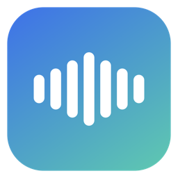

<div align="center">
  
  <h1>BreezeLocal</h1>
  <p><b>在 Apple Silicon Mac 上本地跑 Breeze TTS 2 的原生 App</b><br>
  <sub>模型下载 · 语音合成 · 声音设计 / 克隆 · 本地 MCP 服务，全部不出本机</sub></p>

  <a href="https://github.com/m0ba/BreezeLocal/releases/latest"></a>
  
  
  

  <br><br>
  
</div>

---

## 为什么是它

- **声音不出机器**：模型在本地跑，断网也能合成；没有账号、没有额度、没有上传。
- **开箱能用**：下载 DMG → 选模型 → 点生成。三条下载通道（魔搭 / HF 镜像 / HF 官方），国内不用折腾代理。
- **能给 AI 用**：内置 MCP 服务，Codex、Claude、Cursor 直接调用 `breeze_speak`，让 AI 开口说话。

## 功能

| 能力 | 说明 |
| --- | --- |
| **15 个音色预设** | 甜美女生、初恋女神、御姐、磁性男声、纪录片旁白…每个带适用场景，可先试听再选 |
| **声音设计** | 一句自然语言描述造一个新音色，不用录音 |
| **录音克隆** | 3–30 秒干净录音 + 逐字稿，复刻音色并用指令调语气 |
| **长文分段** | 按标点切句、段间 0.28 秒静音、界面显示「第 3/4 段」 |
| **划词朗读** | 可录制的全局快捷键（默认 `⌥⌘R`）+ 剪贴板按钮 + 菜单栏 |
| **本地接口** | `POST /v1/audio/speech` 返回 24 kHz WAV；附带 `/health` |
| **MCP 四件套** | `breeze_speak` / `breeze_design` / `breeze_clone` / `breeze_status` |
| **导出格式** | WAV（默认）/ MP3 / OGG，设置里切换 |
| **其他** | 浅色 / 深色 / 自动、历史生成、日志导出、缓存清理、检查更新 |

## 下载

| 平台 | 文件 | 说明 |
| --- | --- | --- |
| **macOS 14+ / Apple Silicon** | [`BreezeLocal-<版本>.dmg`](https://github.com/m0ba/BreezeLocal/releases/latest) | 拖进「应用程序」即可 |
| **Windows 10/11** | [`BreezeLocal-Windows-Setup-<版本>.zip`](https://github.com/m0ba/BreezeLocal/releases/latest) | Web 控制台 + 官方 API 启动脚本，需要 NVIDIA 显卡 |

未签名、未公证，首次打开被拦时执行：

```bash
xattr -cr /Applications/BreezeLocal.app
```

## 30 秒上手

1. **装 App**：打开 DMG，把 BreezeLocal 拖进「应用程序」
2. **下模型**：点「添加模型」→ 8bit（4.6 GB），国内点「魔搭」
3. **起服务**：点「启动服务」，状态变绿（首次加载模型 10–30 秒）
4. **出声**：写文字、选音色、`⌘↩` 生成；底部「复制给 AI」把 MCP 配置一次性粘给客户端

## 音色

预设用「声音描述」驱动，所以每个都有明确差异；面板里点「试听」直接生成一句样音。

`自然女声` `甜美女生` `初恋女神` `御姐` `知性女主播` `磁性男声` `帅气男音` `温柔男友` `沉稳大叔` `活力少年` `纪录片旁白` `深夜电台` `有声书讲述` `广告口播` `AI 助手`

模型自带 `S0–S9` 说话人槽位放在「内置」分类，按实测音高标注（S0≈78 Hz、S2≈120 Hz、S5≈145 Hz、S9≈107 Hz），不做过度包装。

## 长文与划词

- **长文**：自动按 `。！？；` 和换行切段，合并到 90 字以内，段间插 0.28 秒静音，最后拼成一条 WAV。实测 264 字 → 4 段 → 52 秒音频。
- **划词朗读**：任意 App 选中文字 → `⌘C` → 按快捷键（默认 `⌥⌘R`）。快捷键在设置里可录制修改，不弹辅助功能授权。
- **系统服务**：把 App 放进「应用程序」后，右键菜单会出现「用 BreezeLocal 朗读」。

## 给 AI 用（MCP）

```json
{
  "mcpServers": {
    "breeze-local": { "url": "http://127.0.0.1:8743/mcp" }
  }
}
```

| 工具 | 用途 |
| --- | --- |
| `breeze_speak(text, voice?, instruct?, cfg_scale?)` | 合成语音，返回 WAV 绝对路径 |
| `breeze_design(text, description)` | 用描述造音色并朗读 |
| `breeze_clone(text, ref_audio, ref_text, instruct?)` | 用参考音频克隆音色 |
| `breeze_status()` | 查看模型、采样率、内存占用 |

MCP 生成的音频只保留最近 5 条（`BREEZE_MCP_KEEP` 可调），避免语音机器人把磁盘写满；界面里生成的文件不受影响。

## 模型与速度

| 档位 | 体积 | 内存 | 说明 |
| --- | ---: | ---: | --- |
| **8bit（推荐）** | 4.60 GB | 6–8 GB | 音质接近 bf16，16 GB 机器默认 |
| 4bit | 3.04 GB | 4–5 GB | 更快更省，音质略降 |
| bf16 | 7.63 GB | 11–12 GB | 原精度，32 GB 内存再考虑 |

实测（M4 / 16 GB / 8bit）：加载 11–22 秒，首字 1.2–4.0 秒，RTF 1.2–2.1，峰值 Metal 5.6 GB。

## 数据与隐私

```
~/Library/Application Support/BreezeLocal/
├── models/    模型
├── outputs/   生成的音频
├── voices/    我的音色
├── cache/     下载缓存
└── logs/      运行日志
```

删除这一个目录即可彻底清除。模型与推理都在本机，App 只在「检查更新」时访问 GitHub。

## 开发

```bash
brew install uv        # 或已有 uv
swift build --disable-sandbox
./scripts/build-local.sh     # sidecar + App + DMG
./scripts/verify-local.sh
```

结构：SwiftUI 外壳 + PyInstaller 打包的 Python sidecar（mlx-audio / MLX / FastAPI / FastMCP）。

## 许可

- App 代码：MIT，见 [LICENSE](LICENSE)
- 模型权重：**BreezeBlue Research and Non-Commercial License**，仅限研究与非商用；本项目不内置权重

界面与工程结构参考 [Laya Local](https://github.com/m0ba/laya-local-app)。版本变更见 [CHANGELOG.md](CHANGELOG.md)。
